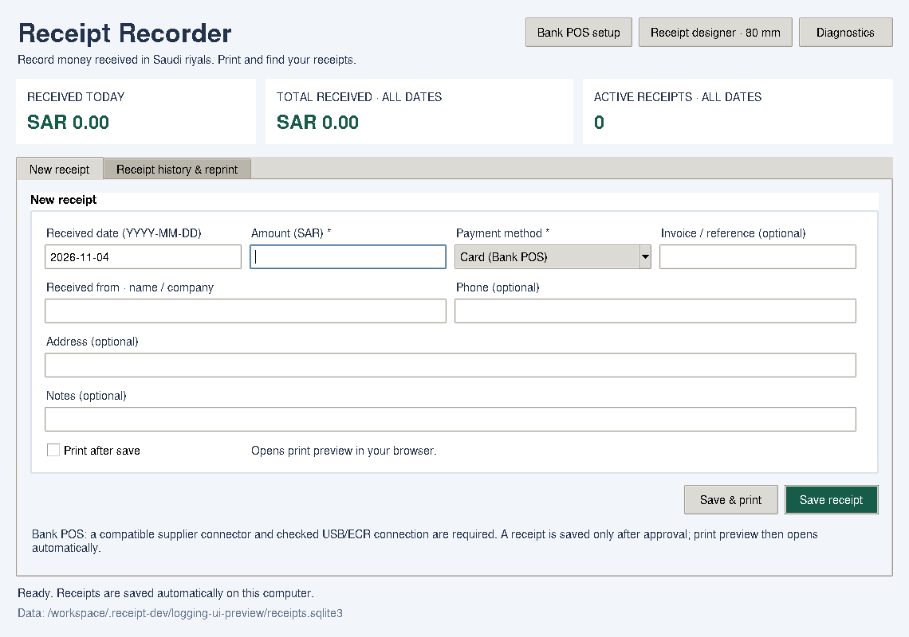
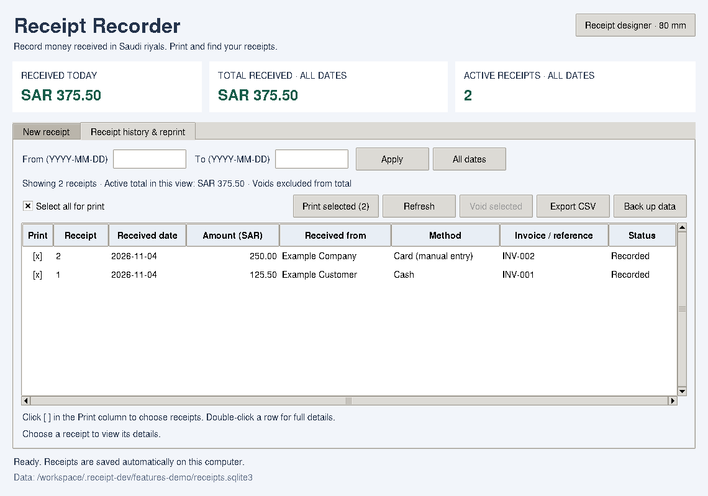
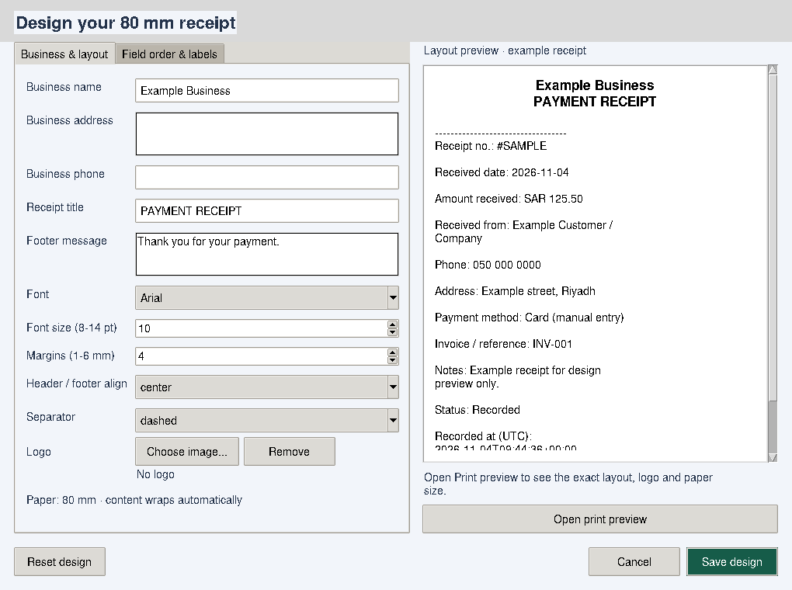
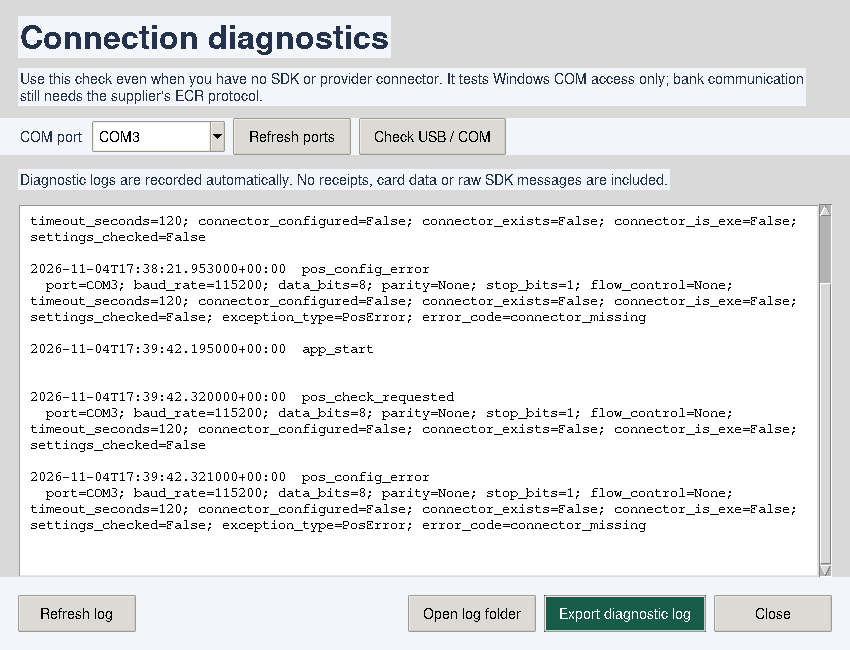
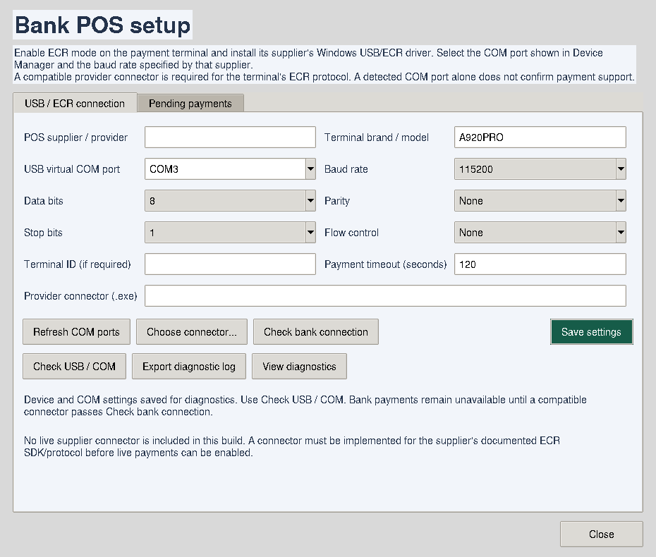

# Receipt Recorder

A small Windows desktop application for recording money received in **Saudi riyals (SAR)**.
Manual methods work offline and save receipts on the computer. The **Card (Bank POS)** workflow
requires a compatible supplier connector. **No live supplier connector is bundled in this build.**
Bank SDK/protocol documentation is still needed to implement and test one for actual terminals.

Version **1.1.0** adds 80 mm thermal receipts, a receipt designer, customer contact details,
date filters and selected-record reprinting.

Version **1.2.0** adds the bank-POS method, a cancellable payment window, USB/COM setup,
connection checking, an approval-only receipt workflow, pending-payment recovery, and card type/last-four
fields in receipts and reports. These paths are validated using test-only connector processes,
not a bank terminal. Devices sharing one ECR protocol can reuse an implemented connector;
different protocols need different connectors even when both expose a COM port.

Version **1.3.0** adds automatic rotating diagnostic logs, an exportable support `.txt` file,
and a Windows USB/COM access check that works without any ECR SDK or provider connector.

Version **1.3.1** lets you save device/COM details for diagnostics without a provider connector.
Saving these preferences does not verify a bank connection or enable card payments.



The preview contains example data only. The application starts with an empty receipt book.

## Run on your Windows computer

1. Install **Python 3.12** from [python.org](https://www.python.org/downloads/windows/).
   Keep Tcl/Tk enabled and select **Add Python to PATH** during installation.
2. Download this project and extract the ZIP to a folder.
3. Double-click **start_windows.bat** in that folder.

No extra Python packages are needed to run the application. Windows 10 or 11 is recommended.
The source supports Python 3.10 and later; the development and packaging target is Python 3.12.

## Record a receipt

Enter the date, amount (for example `125.50`), and payment method, then click **Save receipt**.
You may also enter the received-from name/company, phone, address, invoice/reference, and notes.
Do not put card numbers or PINs in these fields.

- The summary shows today's receipts, all-time receipts, and the number of active receipts.
- **Card (manual entry)** records an amount you have already confirmed on the separate POS machine.
  It does not charge a card or verify that a bank payment succeeded.
- **Card (Bank POS)** starts the configured connector and shows a progress window with **Cancel transaction**.
  A receipt is only created after a matching, approved terminal result. Confirmed cancellation on either
  the app or terminal, and confirmed declines, create no receipt. The approved receipt always opens print preview.
- Open **Receipt history & reprint** to see records. Double-click a row for all details.
- Enter **From** and **To** dates, then click **Apply**. Both boundary dates are included;
  either date can be blank. **All dates** clears the filter. The top summary always covers
  all dates; a separate summary shows the total for the filtered history.
- To correct a mistake, use **Void selected**, then add a replacement receipt.
  The original stays visible and is excluded from totals. Voiding does not issue a bank refund.
- **Export CSV** saves the filtered history, including customer contact details and voided entries,
  for Excel. Use the Status column to exclude voids.
- **Back up data** saves the receipt database, design, embedded logo and print preference.
  Keep backups in another location.

## Print with the Propos PP9000EU (80 mm)

1. Install the **Windows printer driver supplied for your Propos PP9000EU** and confirm that
   a Windows test page prints. The application uses this installed driver, rather than a raw USB protocol.
2. Set the driver's paper to **80 mm receipt/roll paper**.
3. In the app, use **Save & print**, or tick **Print after save** and click **Save receipt**.
4. A local receipt preview opens in your default browser and requests its print dialog.
   Choose the **PP9000EU**, 80 mm paper, **100% scale**, **Margins: None**, and turn browser
   **headers and footers off**. The receipt layout supplies its own margins.
5. Review the preview, then click **Print** in that dialog. If the dialog does not open automatically,
   use the **Print receipts** button at the top of the preview.

The checkbox is remembered after restarting. Printing always uses the saved record, including every
entered detail, receipt ID, amount/currency, received date, status and audit timestamps. If preview
cannot open, the receipt remains saved: reprint it from history instead of entering it again.
Cancelling a print dialog does not cancel or remove the receipt. Opening a preview is not confirmation
that the printer physically printed it.

### Reprint selected receipts

Open **Receipt history & reprint**, optionally filter the dates, and click the **[ ]** boxes in
the **Print** column for the records you want. **Select all for print** selects the visible rows.
Click **Print selected (N)**. Each selected receipt gets its own 80 mm page and a **REPRINT / COPY** label.
Voided receipts are also clearly marked **VOIDED**. Hidden records are not included.
You can also double-click a record and use **Print this receipt** in its details window.



### Design the receipt

Click **Receipt designer · 80 mm**. Customize the business name, address, phone, title, footer,
logo (PNG/JPEG/GIF up to 2 MB), font, font size, margins, header/footer alignment and separators.
The **Field order & labels** tab lets you reorder fields and rename their labels. All receipt
fields stay included. Paper width stays at 80 mm; receipt length adjusts to the content.

The side preview updates as you edit. Use **Open print preview** for the actual browser layout
and logo, then **Save design** to apply it to future prints and reprints. The default 4 mm margins
leave 72 mm for content; adjust them if your driver's printable area differs.
The designer uses an example record and does not create a receipt in your history.



Print previews are generated locally in the data folder's `printouts` directory. The application
does not upload receipts to a website. Generated previews older than seven days are removed when
the next preview is created; the underlying receipt records remain in the database.

The browser layout has been checked as 80 mm pages, including long notes and multiple receipts.
A physical PP9000EU test is still required on your Windows computer.

Amounts are stored as whole halalas (100 halalas = 1 SAR), avoiding floating-point rounding errors.
The date uses the computer's local calendar date. Audit timestamps are stored in UTC.

## Bank POS setup and the remaining live-device requirement

The **Propos PP9000EU is the receipt printer**, not the payment terminal. Use the supplier's ECR
USB driver for the bank POS terminal and its separate serial settings.

### Diagnose USB / COM with only the port number

If you only know the COM port and how to enable ECR/USB, you can use these diagnostics now:

1. Connect the terminal by USB and enable its ECR USB mode.
2. Click **Diagnostics** at the top of the app, then **Refresh ports** and choose the terminal's COM port.
3. With the terminal idle, click **Check USB / COM**. No provider connector, baud-rate guess or payment amount is needed.
4. If there is an error, click **Export diagnostic log**, save the `.txt` file, and attach that file when asking for support.

The same **Check USB / COM** and **Export diagnostic log** buttons are also in **Bank POS setup**.
You can enter your terminal model and COM port and click **Save settings** with the connector field blank.
These details are remembered for the next session. A successful **Check bank connection** is still required
to enable the saved profile for bank payments. Changing connection details clears its previous verification.
Settings needed by unconfirmed payments are preserved until those payments can be reconciled.
The USB check detects whether Windows lists the port, attempts to open it exclusively, reads the host's
current serial configuration, and closes it. When available it also records the selected port's USB
vendor/product IDs (VID/PID) mapped to that port in the Windows registry, which can help identify its driver;
USB serial numbers are excluded. Registry mappings are diagnostic clues, not proof of a terminal's ECR protocol.
It records Windows error numbers for missing, busy,
access-denied or driver/query failures. It never sends serial bytes, ECR probes, purchases or cancellations,
and it does not change the serial settings. A positive result confirms Windows port access only, not a bank
handshake or payment protocol. Host serial defaults are not proof of the terminal's settings.
The check avoids opening the port while a POS operation is active or a payment remains unconfirmed.

Bank **Check bank connection** remains separate and requires a compatible connector. If it reports a
missing connector, that is logged as `connector_missing`; it is not evidence that the USB cable is faulty.



### Diagnostic log files and privacy

Logs are created automatically in:

```text
%LOCALAPPDATA%\ReceiptRecorder\logs\receipt-recorder.log
```

The current file rotates at about 1 MB, with up to three older copies. **Open log folder** opens that folder.
Prefer **Export diagnostic log** for sharing: it combines recent events with the app/Windows versions,
detected ports and configured COM parameters, and filters every record again before writing the `.txt` file.
Times are in UTC. Events include configuration failures, connector start/handshake errors, cancellations,
timeouts, final outcome categories, app exceptions and printing/database errors.

The app logs fixed event/error codes, exception types and product-module line numbers rather than arbitrary
exception messages or local file paths. Customer names, phones, addresses, notes, amounts, invoices, card
data, bank references, provider labels, connector paths, environment values, raw SDK packets and the receipt
database are excluded. Payment correlation uses a short hash of the request ID. Nothing is uploaded
automatically; you decide whether to share the exported file. Logging failures do not change receipt/payment outcomes.

## Configure an implemented supplier connector

1. Ask the POS supplier to enable ECR integration and provide the **ECR protocol name/version,
   official Windows SDK or interface specification, USB driver, serial settings, and test access**.
   A COM number and ECR mode alone do not define how to purchase, cancel or verify a payment.
2. A Receipt Recorder connector must be implemented for that SDK/protocol. The existing sample GUI
   and an arbitrary SDK DLL/EXE are not compatible connectors. See the
   [connector specification](docs/pos-connector-protocol.md).
3. Connect the USB cable, install the official driver, and find the terminal under
   **Device Manager → Ports (COM & LPT)**. If it does not expose a virtual COM port, this USB/serial
   profile is not applicable; that supplier needs another transport adapter.
4. Open **Bank POS setup → USB / ECR connection**. Choose the provider connector, COM port,
   baud rate, data bits, parity, stop bits, flow control, and terminal ID if the supplier requires it.
   The displayed defaults are editable and do not establish compatibility; use the supplier's values.
5. Click **Check bank connection**. It must confirm an actual terminal handshake through the connector.
   COM discovery merely lists ports; it sends no payment. Save settings after a successful check.
   A changed connector or connection setting requires another check.

Do not expect live payments from this build until step 2 is completed for a documented supplier protocol.
There is no built-in test-payment or simulated-approval choice in the application.



### Approval, cancellation and recovery

The entered receipt details and a unique request ID are saved in a separate payment journal before a
purchase is sent. This journal is not a receipt and is excluded from receipt totals.

- **Cancel transaction** sends a cancellation request after purchase submission and keeps the window
  open for terminal confirmation. A cancellation acknowledgement alone does not prove cancellation.
- If approval arrives before cancellation is confirmed, the approved payment is recorded and the app
  explains that any required bank refund must be handled with the provider. It never invents a cancellation.
- A timeout, disconnection, mismatched response or unexpected process exit after submission leaves
  the outcome **unconfirmed**. No receipt is created and another bank charge is blocked, including after restart.
- Open **Bank POS setup → Pending payments**, select the request and choose **Check selected payment status**.
  This queries the original request through the same provider; it never resends a purchase. A confirmed approval
  records the receipt once, while confirmed decline/cancellation releases the pending request without a receipt.
- If the provider cannot confirm the outcome, it remains pending. The supplier must supply a status/reconciliation
  mechanism; deleting the journal or assuming a timeout means failure is not a recovery method.
- If the terminal approved but the database write fails, keep the request ID and reconcile the original payment;
  do not create another charge. A receipt replay for the same approved request is idempotent.

The application retains the supplied card brand and **only four card-ending digits** from connector responses.
It does not retain full card numbers, PINs, CVVs, track data or raw SDK responses. A missing brand/last four is
shown as **Not supplied by terminal**, rather than guessed. CSV masks card endings as `**** 0012` so Excel
does not remove leading zeros. Bank transaction ID, approval code, terminal ID and provider are also available
in receipt details, printouts and the CSV report. Existing manual receipts and saved print designs are preserved.

## Where the data is saved

On Windows:

```text
%LOCALAPPDATA%\ReceiptRecorder\receipts.sqlite3
```

Paste `%LOCALAPPDATA%\ReceiptRecorder` into File Explorer's address bar to open this folder.
Closing, upgrading, or moving the application does not erase this data.
This is a local receipt book for one Windows user, without sign-in, encryption, or bank reconciliation.

To restore a backup: close all copies of the app, keep a copy of the current database,
then copy your backup into this folder and name it `receipts.sqlite3`.
Reopen the application and verify the receipts. CSV exports are reports, not database backups.

### Upgrade from version 1.0

Use **Back up data** in the old app, then close it. Download the new Windows build, extract it,
and run its `ReceiptRecorder.exe` as the same Windows user. It finds your existing data automatically.
On first launch it adds missing fields without changing receipt numbers or amounts. The printing migration
creates `receipts-before-printing-update.sqlite3`; the bank-POS migration creates
`receipts-before-bank-pos-update.sqlite3` beside the live database when the corresponding fields are first added.

To use a separate data folder:

```powershell
py -3 app.py --data-dir "C:\MyReceiptBook"
```

## Build an EXE

On Windows with Python installed, double-click **build_windows.bat**.
It creates `dist\ReceiptRecorder.exe`. The resulting EXE runs without a separate Python installation.
Build it on Windows; PyInstaller cannot build a Windows EXE from Linux.
The EXE is unsigned, so Windows may show an unknown-publisher notice.

Alternatively, after this project has been pushed to GitHub, open **Actions → Build Windows application → Run workflow**.
Download the **ReceiptRecorder-Windows** artifact from a successful run and extract the EXE.
Build results and downloadable files appear in the Actions run.

## Supplied reference application

The supplied `ViknPOSIntegration.exe` is a compiled .NET 8 Windows application. Static inspection
found COM-port, baud-rate, purchase-amount and payment-result components, along with Mada SDK components.
It was inspected as a reference, not executed or copied into this application. Static SDK metadata includes
COM connection, connection testing, purchase and cancellation entry points, but does not establish the
supported terminal protocols, response mappings, status reconciliation or current SDK distribution rights.
The reference application's bundled SDK binaries are not published in this repository or packaged into the app.

The receipt-recording logic is separate from the screen and accepts confirmed results through the documented
connector boundary. Different suppliers may need different SDKs, protocols, drivers and ECR settings.
A universal connector cannot be assumed from the brand or the COM port alone.

For each intended integration, obtain the provider's ECR/POS integration documentation and SDK,
supported terminal models, connection type (USB/serial/LAN), and test access. A connector should
only record a payment once after an approved response; declines and timeouts must not be treated
as receipts. Test timeout/recovery and duplicate prevention before using real payments.

## Development

Use the existing checkout in the isolated cloud task; a Git worktree is unnecessary.

```bash
cd /workspace/BANK-POS-INTEGRATION
python3 -m unittest discover -s tests -v
python3 app.py --data-dir /tmp/receipt-recorder-demo
```

Tkinter needs a graphical display. In a headless Linux environment, run the GUI tests with Xvfb;
the ledger tests also run without a display. The desktop smoke test uses a temporary database,
creates a receipt through the UI, checks totals/history, restarts the UI against the same database,
then verifies export, backup, and void behavior. It does not charge a card or contact a bank.

The suite also exercises database upgrades, customer details, print failures after saving,
date-range filtering, selected reprints and the designer. Bank workflow tests cover approval, both cancellation
sources, cancellation races, disconnections, malformed/mismatched results, duplicate prevention, restart recovery,
and data minimization. Test-only helper processes are under `tests/` and are not packaged into the Windows EXE.
Passing these tests does not validate any supplier SDK or certify a live terminal connection.
For a real browser check:

```bash
python3 -m pip install -r requirements-test.txt
python3 scripts/check_print_layout.py
```

This optional check uses installed Microsoft Edge on Windows or Chromium on Linux. It tests
the receipt's print button without sending a printer job, renders a PDF, and verifies the 80 mm
width, separate pages and complete long notes. It also runs in the Windows build workflow.

Do not commit receipt databases, private payment details, generated EXEs or the supplied reference binary.
